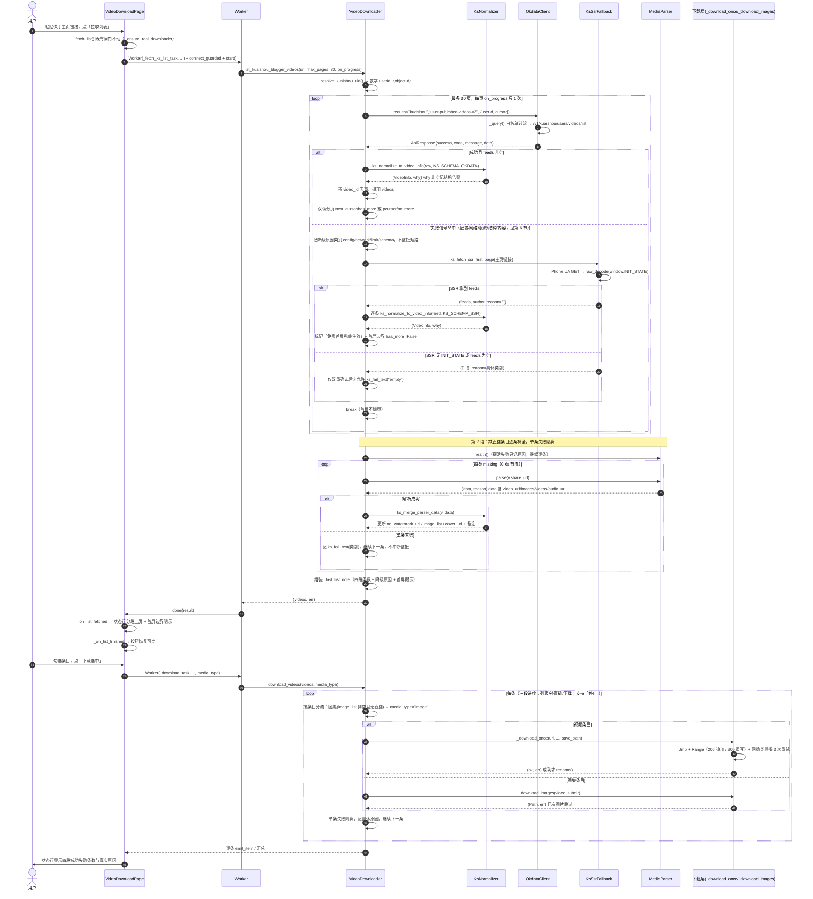
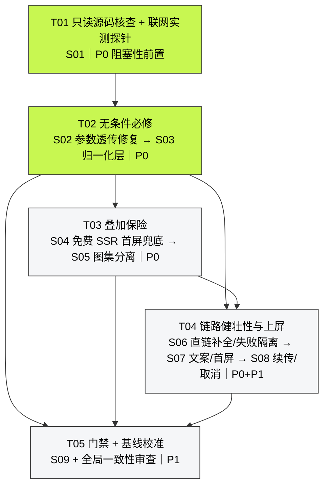

# 快手批量解析优化 · 增量架构设计 + 有序任务列表

> 类型：增量设计（只描述本轮变更，不重复既有系统定义）｜全中文｜技术标识符、代码、命令、字段名、行号保留原词
> 产出：高见远（架构师）｜唯一回传对象：主理人齐活林｜上游输入：《快手批量解析优化 · 增量 PRD》（许清楚）、`快手批量解析实现拆解-wechat-mp-tools.md`（496 行）、主理人下发的工程现状锚点
> 工程：`D:\trafficcatcher-src\justoneapi-collector`｜本轮只落工作区，**不打包、不 push、不发版、不升版本号、不执行任何对外动作**

---

## 0. 严谨性声明（必须遵守）

客户只反馈「快手无法批量解析提取音视频」，**未提供复现步骤与具体报错**。PRD 第 2 节 H1~H22 共 22 条全部是「需工程实测确认的假设」，本设计**不认定任何已确认根因**，不把假设写进结论或发版说明。

本设计第 1 节把主理人点名的两条高优先假设做了**只读源码核查**，结论分两档：

- **「源码层面已确认」**：仅凭静态读源码即可判定，不需要联网，可作为设计依据；
- **「需 T01 联网实测」**：涉及 okdata 服务端实际返回、快手页面实际结构、`video.zacao.top` 实际响应，必须由 T01 探针真发一次请求确认，**严禁在实测前写死为根因**。

另外，本设计对主理人下发的两条假设做了**精确修正**（见 1.3），工程师按修正后的口径执行，不要照抄旧表述。

---

# 第一部分 · 增量架构设计

## 1. 只读源码核查结论

### 1.1 源码层面已确认（无需联网，静态可读）

| 编号 | 核查对象与行号 | 源码事实 | 对应假设 |
|---|---|---|---|
| F1 | `okdata_client.py:139-140` | `_PASSTHROUGH = {"id","url","query","cursor","view","fields","sort","lang","tab","type","published_within"}`，**确实不含 `pcursor` / `count`**；`PARAM_ALIAS:127-138` 也无二者映射 | H2（请求侧） |
| F2 | `okdata_client.py:322-332` `_query()` | `name = PARAM_ALIAS.get(src, src if src in _PASSTHROUGH else "")`，随后 `if name not in _PASSTHROUGH ...: continue`。`pcursor` / `count` 的 `name` 恒为 `""` → **被丢弃**；`userId` 经 `PARAM_ALIAS` 变 `id` 才保留 | H2（请求侧） |
| F3 | `video_downloader.py:3412` | `params = {"userId": int(uid), "pcursor": pcursor, "count": 20}` → 经默认 `okdata` 通道 `_query()` 后**只剩 `{"id": uid}`**，翻页游标根本没发出去 | H2（请求侧） |
| F4 | `okdata_client.py:266-275` `_translate()` | 列表响应输出 `page` / `next_cursor` / `max_cursor` / `cursor` / `nextCursor` / `has_more` / `hasMore`，**不产出 `pcursor`，也不产出 `no_more` 哨兵** | H2（响应侧） |
| F5 | `video_downloader.py:3439-3441` | `pcursor = str(data.get("pcursor") or "no_more")`，再判 `if pcursor in ("no_more","","None"): break` → 在默认通道下 `data.get("pcursor")` 恒为空 → **第一页后立即 break**。H2 是「请求侧丢参数 + 响应侧字段不匹配」双向问题，源码层面可确认「批量只拿第一页」 | H2 |
| F6 | `okdata_client.py:166-242` `_decorate()` | `d = dict(obj)` 保留原生 `id` / `text` / `title` / `cover_url` / `images` / `published_at` / `author` / `metrics`；补 `nickname` / `nick_name` / `user_name` / `desc` / `text` / `title` / `aweme_id` / `note_id` / `video_id` / `item_id` / `post_id` / `digg_count` / `comment_count` / `share_count` / `play_count` / `create_time` / `cover` / `cover_url` / `sec_uid` / `user_id`。**不产出 `main_mv_urls` / `playUrl` / `photo_id` / `caption` / `like_count` / `timestamp` / `image_list`** | H6 / H7 |
| F7 | `video_downloader.py:3070-3083` `_to_video_info_p()` 快手分支 | `vid` 候选路径含 `id` 兜底，因 `_decorate()` 保留 `id`，**`video_id` 并不为空**；但 `play` 只找 `main_mv_urls.0.url` / `mainMvUrls.0.url` / `playUrl` / `urlInfo.url` → **恒空**；`cover` 找 `coverUrl` / `cover_urls.0.url` / ... 取不到 `_decorate()` 的 `cover` / `cover_url` → 恒空；`digg` 找 `like_count` 取不到 `digg_count` → 恒 0；`image_list` 恒空 | H6 / H7 / H12（**修正见 1.3**） |
| F8 | `video_downloader.py:3432` | `v.share_url = f"https://www.kuaishou.com/short-video/{v.video_id}"`，用 `video_id` 拼作品页；若 okdata 的 `id` 不是快手 `photo_id`，该 URL 就是错的，第 2 段逐条补全会全灭 | H14（**需实测**） |
| F9 | `video_downloader.py:3419-3420`、`:3444`、`gui_qt/pages/video_download_page.py:216`、`:254`、`:1366` | 共 5 处把失败/空结果一律归因成「该账号可能没有公开作品」「列表为空（可能该账号未公开或确实为空）」 | H20 |
| F10 | `video_downloader.py:3477-3481` | 收尾文案只有 `快手作品 N 条`，无四段条数、无降级原因 | H21 |
| F11 | `video_downloader.py:3454-3460` | 第 2 段补全前一次 `health()` 探活，失败即 `svc_unavailable = "解析服务当前不可用"`，**整批不补** | H13 |
| F12 | `video_downloader.py:3472-3473` | 只取 `data.get("video_url")`；而 `media_parser.py:387-398` 实际返回 `video_url` / `images` / `videos` / `audio_url` 等 → **`images` / `videos` 被整条丢弃** | H11 |
| F13 | `video_downloader.py:2669-2683` `_reparse_for_fresh_url()` 快手分支 | 只 `replace(video, no_watermark_url=new_url)`，不碰 `image_list` | H16 |
| F14 | `video_downloader.py:2823-2875` `_download_once()` | `open(save_path, "wb")` 直接写目标文件，**无 `.tmp` + `Range` 续传**；但 `:2933-2937` 的 `_download_images()` 已有「文件存在且非空即跳过」的天然续传 | H17 |
| F15 | `video_downloader.py:2523-2527` `download_video()` | `media_type == "image"` 已走 `_download_images()`；但 `gui_qt/pages/video_download_page.py:1498` 的 `media_type` 来自 `media_combo.currentData()`，是**一次批量全局共用的下拉值，不按条目自动分流** → 图集能力虽存在却不可达 | H12 / P0-4 关键落点 |
| F16 | `video_downloader.py:202-227` `VideoInfo` | 字段为 `video_id` / `desc` / `author` / `sec_uid` / `create_time` / `duration` / `digg_count` / `cover_url` / `no_watermark_url` / `share_url` / `image_list` / `platform` / `comment_count` / `share_count`；注释明确「有 4 条构造路径，任何一条多传/少传字段都会抛 TypeError，新字段一律追加末尾」 | 归一化层设计约束 |
| F17 | `media_parser.py:230-331` / `:334-398` / `:401-422` / `:425-437` | `parse(text) -> (dict|None, str)`；`_normalize_data()` 返回 `platform` / `platform_name` / `video_id` / `title` / `author` / `cover_url` / `audio_url` / `video_url` / `images` / `videos`（`videos` 为 `[(url, cover), ...]`）；`health() -> (bool, str)`；`platform_from_url():406-407` 快手判定含 `chenzhongtech` | 归一化第 ④ 类 |
| F18 | `gui_qt/pages/video_download_page.py:279-335` `_batch_bloggers_task()` | `_SegmentWorker` 串行 + `video_id` 集合去重（`:293-327`）+ 单博主失败隔离（`:316-317`、`:319-320`）已具备 | P1-5 / P1-6 复用点 |
| F19 | `tools/_validate_okdata.py:118-119` | 既有门禁断言 `q = _query({"secUid":..., "count":20, "cursor":0, "pageSize":20})` 必须等于 `{"id": ...}`，即 **`count` 被丢弃是门禁钉死的行为** | **T02 硬约束，见 2.4** |
| F20 | `tools/release_all.py`（实跑统计） | `[中止]` 判据当前 **50 条**；`tools/_validate_release_chain.py:80-83` 基线 `n_abort >= 50`，注释与 f-string 都写 50 | 门禁联动 |
| F21 | `tools/release_all.py:983-1007` | 门禁顺序为 `_validate_xhs_notes.py`（:983-987）→ `_validate_ui_copy.py`（:994-998）→ `_validate_free_nav.py`（:1000-1004）→ `if not args.no_pack:`（:1007）。上一轮 6 个 M 改动已落地，严禁覆盖或重排 | 门禁插入点，见 T05 |
| F22 | `justoneapi_collector.spec:88-234` | `hiddenimports` 已含 `justoneapi_collector.video_downloader`（:118）、`media_parser`（:144/:148）、`okdata_client`（:140）；`video_downloader.py:20` 顶层已有 `import json`、`:32` 已有 `import httpx`、`:28` 已有 `from dataclasses import ... replace` | **零新增打包改动**的依据 |
| F23 | `gui_qt/pages/video_download_page.py:1273-1281` `_fetch_list()` | 既有闸门是 `_ensure_real_downloader()` + `_free_mode()` + `_prompt_paid_feature()`，不是 `require_feature(...)`；本轮既有位置不动 | 付费边界 |
| F24 | `video_downloader.py:3387-3483` | 返回契约 `(list[VideoInfo], str)` 不变；`_last_list_note` 是下载器 → UI（`video_download_page.py:1372`）唯一收尾通道 | 跨文件约定 |

### 1.2 需 T01 联网实测确认（严禁写死为根因）

| 编号 | 待测事实 | 影响的设计点 |
|---|---|---|
| U1 | okdata `kuaishou.users.videos.list` 是否接受 `cursor` 参数；`page.next_cursor` / `has_more` 的实际形态与取值 | T02 参数透传修复的最终参数名 |
| U2 | okdata Post 对象的 `id` 是否**等于快手 `photo_id`**（而非内部 ID） | T02/T03 的 `share_url` 拼接规则、H14 |
| U3 | okdata `_decorate()` 输出中 `images` 是否含可用图集 URL；`published_at` 是 ISO 字符串还是秒级整数 | T03 的 `image_list` 与 `create_time` 口径 |
| U4 | `user-profile-v1` 在 okdata 下是否仍返回 `shareInfo.webShareVerifyData.objectId` | H1；若不含，`_resolve_kuaishou_uid()` 需补兜底 |
| U5 | 免费移动端 SSR 页面 `window.INIT_STATE` 的实际结构、`feeds` 节点与 `photo` / `workType` / `atlas` 字段名 | T03 的 SSR schema 映射 |
| U6 | `video.zacao.top` 对 `https://www.kuaishou.com/short-video/<id>` 的返回 `data` 里 `images` / `videos` 是否填充、`_ERR_TEXT` 文案与 429 表现 | T04 的直链补全与失败分级 |

### 1.3 对主理人两条高优先假设的精确修正（重要）

主理人下发的表述是「`_to_video_info_p` 硬编码吃扁平字段 → `video_id` 为空、条目被丢弃、整批暂缺下载地址」。只读核查后的准确口径是：

1. **`video_id` 不为空**：`_decorate()` 保留原生 `id`，而 `_to_video_info_p` 快手分支的 `vid` 候选路径第三项就是 `id`，所以条目不会被丢弃（`:3431` 的 `if v and v.video_id` 能过）。
2. **真正源码可确认的回归是两处**：
   - **H2 双向断裂**（F1~F5）：请求侧 `pcursor` / `count` 被 `_query()` 丢弃，响应侧 `_translate()` 不产出 `pcursor` → 批量**固定只拿第一页**；
   - **H7 播放地址恒空 + 归一化字段口径错位**（F6~F7）：`no_watermark_url` / `image_list` / `cover_url` / `digg_count` 全部取不到，所有条目被压到第 2 段逐条补全。
3. **最可能的「整批暂缺下载地址」链路（仍属假设）**：`share_url` 用 `video_id` 拼 `short-video/<id>`（F8），若 U2 实测 `id` 不是 `photo_id`，则 zacao 逐条解析全灭；再叠加 `health()` 探活失败整批短路（F11）→ 客户看到「整批暂缺下载地址」。**这条链路必须等 T01 实测才能定性**。
4. 因此设计把「参数透传修复 + 归一化层兼容 okdata 统一对象」定为**无条件必修**，把「`share_url` 拼接口径」列为**待 U2 实测后定**，不擅自改拼接规则。

---

## 2. 实现方案与方案权重（定死，工程师不得自由发挥）

### 2.1 核心技术难点

| 难点 | 说明 | 解法 |
|---|---|---|
| 默认付费通道的**兼容性回归** | 切到 `okdata` 后，参数白名单、响应分页字段、条目 schema 三处与旧通道全线错位（F1~F7） | 调用侧双读兼容 + 快手专用归一化层，**不动 `_translate()` / `_query()` 全平台共用逻辑** |
| 四类上游 schema 收敛一处 | ① okdata 统一对象 ② 旧通道扁平 `feeds` ③ 免费 SSR `INIT_STATE.feeds` ④ `media_parser` 归一化 dict | 新增模块级纯函数 `ks_normalize_to_video_info()`，`_to_video_info_p` 对其他平台零影响 |
| 免费兜底不能越界 | 不新增付费接口 / 页面 / 功能位 / 凭据 / 浏览器 | 移动端 SSR 首屏，纯 `httpx` GET + `raw_decode()`，放在既有 `video_downloader.py` 内 |
| 图集能力已存在却不可达 | `download_video()` 有 `image` 分支，但 `media_type` 是全局下拉（F15） | 在 `download_videos()` 内**按条目自动分流**，不动 UI 下拉、不改 `VideoInfo` 结构 |
| 失败不可诊断 | 5 处误导文案、收尾只有一句、探活整批短路 | 失败原因分级常量表 + `_last_list_note` 分段上屏 + 单条失败隔离 |
| 门禁基线联动 | 新增门禁使 `[中止]` +1，`_validate_release_chain.py` 基线 50 会误报 | 三处同改（注释 / 判据 / f-string）→ 51，并实跑负例 |

### 2.2 框架与库选型（全部沿用既有，零新增第三方依赖）

| 选型 | 理由 |
|---|---|
| Python 3.10 + PySide6/Qt 桌面客户端 | PRD 明确「不新建项目、不引入前端栈」 |
| `httpx`（工程已有，spec 已登记） | SSR 兜底、列表请求、下载层全部复用；不引 `requests` |
| `json.JSONDecoder().raw_decode()`（标准库，`video_downloader.py:20` 已 `import json`） | 学习材料 §3.1 / §9 / §12.1，稳健截取 `window.INIT_STATE`，比正则可靠 |
| `dataclasses.replace()`（`video_downloader.py:28` 已有） | 重解析只换字段、保留元数据 |
| 纯标准库门禁脚本（`ast` / `re` / `sys` / `pathlib`） | 风格参照 `tools/_validate_titlebar.py`，不联网、不扣费 |
| 架构模式 | **分层 + 归一化适配层**：采集通道层（okdata / 旧通道 / SSR）→ 归一化层 → 直链补全层 → 下载层 → UI 呈现层；变化点收敛在归一化函数与 SSR 函数两处，外层调用契约不变 |

**明确不引入**：Playwright / Chromium、Flask、代理池评分、扫码登录 / Cookie 落盘、全局单例任务状态机、Web 式 1s 轮询、新付费 SDK、任务表落库。

### 2.3 两级降级架构（PM 三级精简为两级，主理人已认可）

```
第 1 级：完整采集通道（okdata 默认 / 用户可切回旧通道）
   │  触发：正常路径，不额外发请求、不拖慢批量
   │  失败信号见第 6 节「降级触发条件表」
   ▼
第 2 级：免费移动端 SSR 首屏兜底（仅首屏，has_more=False，UI 明示边界）
       定位：付费彻底不可用（Key 缺失 / 余额不足 / 接口暂停 / 字段全不兼容）时的最后一层
       不进付费闸门、不显示任何 Key/余额/激活类字样、不新增 ENDPOINT_MAP 映射
```

三链路铁律不变：① 采集/列表 → `okdata`（默认，自填 `okd_` Key，可切回旧通道）② 视频/图文直链 → `video.zacao.top`（免费、不进闸门）③ 直播录制 → 本地 ffmpeg。免费 SSR 属「列表采集通道内部的免费数据源」，不是第四条链路。

### 2.4 方案权重（**写死，工程师按此顺序，不得自由发挥**）

| 权重 | 内容 | 说明 |
|---|---|---|
| **无条件必修（最高）** | **参数透传修复 + 归一化层兼容 okdata 统一对象**（T02） | 不管 SSR 兜底做不做，正常批量路径必须是好的；这是「修回归」，不是「加能力」 |
| **叠加的免费保险（P0，但排在必修之后）** | **免费 SSR 首屏兜底**（T03 前半） | 叠加在修好回归之上的最后一层，付费成功时绝不触发、不发额外请求 |
| **随后补齐** | 图集分离 → 直链补全/失败隔离 → 文案与首屏边界 → 断点续传/取消 → 门禁 | 按主理人指定顺序，见第二部分 T01~T05 |
| **严禁** | 一上来堆 SSR 通道，把 okdata 兼容性回归盖过去 | 那会让客户主诉的根因永远查不出来 |
| **严禁** | 把 `count` / `pcursor` 加进 `_PASSTHROUGH`；改 `_translate()` 让它输出 `pcursor` | `tools/_validate_okdata.py:118-119` 钉死 `count` 应被丢弃；`_translate()` 全平台共用，改了会扩散到抖音/小红书，违反最小变更 |
| **严禁** | 新建 `.py` 模块 / 新增 `hiddenimports` 条目 | 放既有 `video_downloader.py`（spec 已登记），保持零打包改动 |
| **严禁** | 改 `_to_video_info_p()` 的抖音/小红书/TikTok 分支 | 新增快手专用归一化函数，其他平台零影响（PM Q7） |

**T02 的正确修法（定死）**：改**调用侧**，不动 `okdata_client.py`。

- 请求侧：`video_downloader.py:3412` 的 `{"userId": int(uid), "pcursor": pcursor, "count": 20}` → 改为 `{"userId": int(uid), "cursor": pcursor}`。`userId` 经 `PARAM_ALIAS` → `id`；`cursor` 在 `_PASSTHROUGH` 白名单直接透传；`_query():327` 的 `value in (None,"",0,[],{})` 会自动丢弃首页空串、透传翻页非空串；`count` 直接去掉（okdata 不接受，且门禁钉死应被丢弃）。旧通道仍需 `pcursor` / `count` 时，按 `getattr(self.client, "provider", "") == "okdata"` 分流构造参数，**两套参数名并存**，互不干扰。
- 响应侧：`video_downloader.py:3439-3441` 改为**双读**：优先读 okdata 口径 `data.get("next_cursor")` / `data.get("cursor")` + `data.get("has_more")`；无 `has_more` 键时回落旧通道口径 `data.get("pcursor")` + `"no_more"` 哨兵。加「有 `has_more=True` 但无有效游标」的防死循环保护，最多 30 页上限保持。
- 若 U1 实测发现 okdata 列表接口分页参数名不是 `cursor`，**以实测为准**在 T02 里调整参数名，但仍不得改 `_translate()`。

### 2.5 若 H2 / H6 实测成立 / 不成立的方案权重分支

| T01 实测结果 | 权重调整 |
|---|---|
| **H2 成立**（参数未透传 / 响应字段不匹配） | T02 参数透传修复 = 最高优先，必修；SSR 降为 P0 但排在其后。客户「只剩第一页」由 T02 直接解决 |
| **H2 不成立** | T02 仍做「双读兼容」防御性改造（不改 `_translate()`），但排查重心转向 U4（H1）、H3、H13、H14；T04 直链补全与失败隔离权重上升 |
| **H6 / H7 成立**（统一对象不含播放地址、归一化字段口径错位） | T03 归一化层 = 最高优先，必修；`share_url` 拼接按 U2 实测结果定；`image_list` 从 `images` 补齐 |
| **H6 不成立**（okdata 仍返回扁平 `feeds`） | T03 仍做（四类 schema 统一是长期价值，且 SSR 兜底必须依赖它），但优先级可让位给 T04 直链补全 / 失败隔离 |
| **两条都不成立** | 客户主诉更可能落在 H13（探活短路）/ H14（链接形态）/ H15（zacao 覆盖率）；T04 与 SSR 权重上升，T01 报告必须附实测证据，不得凭猜测继续 |

> 无论哪种分支，**「参数透传修复 + 归一化层」都是无条件必修项**，不因实测结果取消。

---

## 3. 模块划分与文件清单

> 只列本轮变更文件。**不新增页面 → 不动 `gui_qt/page_registry.py` 的 `PAGES`、不跑 `tools/gen_pages.py`；不新增功能位 → 不动 `licensing.FEATURES` / `FEATURE_BACKFILL` / 真 deny。**

| 相对路径 | 职责 | 是否新增 | 改动边界（行号） |
|---|---|---|---|
| `justoneapi_collector/video_downloader.py` | **本轮主改动**。新增 `ks_` 归一化函数、SSR 兜底函数、失败原因常量表、图集判定；修复参数透传与分页双读；改第 2 段补全、图集下载分流、`.tmp`+`Range` 续传 | 否（既有，改动） | 模块级工具区 `:231-415`（新增函数，紧邻 `class VideoDownloader: :416` 之前）；`_to_video_info_p:3043-3114` 保持不动；`_reparse_for_fresh_url:2658-2684`；`_download_once:2823-2875`；`_download_images:2914-2957`（不改）；`download_video:2509-2534`（不改）；`download_videos:2978`；`_resolve_kuaishou_uid:3328-3385`（仅在 U4 实测需要时补兜底）；`list_kuaishou_blogger_videos:3387-3483` |
| `justoneapi_collector/okdata_client.py` | **只读核查对象，本轮不改** | 否（不改） | `:62-123` `ENDPOINT_MAP`、`:127-140` `PARAM_ALIAS` / `_PASSTHROUGH`、`:166-242` `_decorate()`、`:245-282` `_translate()`、`:322-332` `_query()` 全部保持原样 |
| `justoneapi_collector/media_parser.py` | **只读复用，本轮不改** | 否（不改） | `parse:230`、`_normalize_data:334-398`、`platform_from_url:401-422`、`health:425-437` 契约不变 |
| `gui_qt/pages/video_download_page.py` | 状态行分段上屏、首屏边界文案、误导文案替换、三段进度与「停止」入口、图集条目表格可区分 | 否（既有，改动） | `:216`、`:237-255`、`:279-335`、`:338`（`should_stop` 形态参考）、`:102-178` `_download_task`、`:1273-1281`（闸门**不动**）、`:1288-1307` 快手 UI 分支、`:1357-1384` `_on_list_fetched` / `_on_list_finished`、`:1498` `media_type`（**下拉不动**） |
| `justoneapi_collector.spec` | **只读确认，本轮不改** | 否（不改） | `:88-234` `hiddenimports` 已含 `video_downloader` / `media_parser` / `okdata_client`；因新增函数都在既有模块内，零新增条目 |
| `tools/_validate_ks_batch.py` | **新增门禁**（P1-7）：纯标准库校验免费兜底文案禁用词 / 首屏边界文案 / 归一化四类字段覆盖 / Worker 铁律 / 三链路边界 | **是（新增）** | 全文件，风格参照 `tools/_validate_titlebar.py` |
| `tools/release_all.py` | 追加 1 条门禁调用（**仅追加，不覆盖、不重排**上一轮 6 个 M 改动） | 否（既有，最小追加） | 精确插入点：`:1004`（`_validate_free_nav.py` 块的 `return 1`）**之后**、`:1006` 注释行与 `:1007 if not args.no_pack:` **之前** |
| `tools/_validate_release_chain.py` | 中止判据基线 50 → 51（注释、判据、f-string 三处同改） | 否（既有，改动） | `:80-83` |
| `docs/design/快手批量解析优化-增量设计.md` | 本设计文档 | **是（新增文档）** | 全文件 |
| `docs/design/class-diagram.mermaid` | 类图单独落盘 | **是（新增文档）** | 全文件 |
| `docs/design/sequence-diagram.mermaid` | 时序图单独落盘 | **是（新增文档）** | 全文件 |

> **关于 `tools/release_all.py` 插入点的说明**：主理人表述为「在 `_validate_xhs_notes.py` 之后、`if not args.no_pack:` 之前追加一条」。实读发现 `_validate_xhs_notes.py`（:983-987）之后还有 `_validate_ui_copy.py`（:994-998）与 `_validate_free_nav.py`（:1000-1004）两块上一轮改动。为「严禁覆盖或重排」，实际应插在**最后一块 `_validate_free_nav.py` 之后**（即 :1004 之后），仍满足「在 `if not args.no_pack:` 之前」。工程师按 `:1004` 之后的精确位置执行。

---

## 4. 数据结构与接口

### 4.1 新增函数签名、所在文件与行号、调用点

#### 4.1.1 快手专用归一化函数（PM Q7 采纳「新增函数」）

```python
# 文件：justoneapi_collector/video_downloader.py
# 位置：模块级工具函数区（:231-415），建议紧邻 class VideoDownloader（:416）之前
# 依赖：_deep_get（:119）、_to_int_safe（:159）、VideoInfo（:203）——全部同文件已有

KS_SCHEMA_OKDATA = "okdata"     # ① 默认采集通道统一对象（_decorate 输出）
KS_SCHEMA_LEGACY = "legacy"     # ② 旧通道扁平 feeds
KS_SCHEMA_SSR    = "ssr"        # ③ 免费移动端 SSR INIT_STATE.feeds
KS_SCHEMA_PARSER = "parser"     # ④ media_parser.parse() 归一化 dict

def ks_normalize_to_video_info(
    raw: dict,
    source: str,
    *,
    share_url: str = "",
    author_fallback: str = "",
) -> tuple[VideoInfo | None, str]:
    """把四类上游 schema 统一成 VideoInfo。

    返回 (VideoInfo | None, 失败原因)。失败原因非空表示这条被丢弃的真实原因
    （结构类 / 内容类），调用方逐条记账、绝不静默吞掉，也不抛异常。
    纯函数、无 self、无网络，便于门禁脚本直接喂四类样本做离线断言。
    """
```

**调用点（3 处，全部在 `video_downloader.py`）**：

| 调用点 | 现状 | 改为 |
|---|---|---|
| `list_kuaishou_blogger_videos():3430` | `v = self._to_video_info_p("kuaishou", raw)` | `v, why = ks_normalize_to_video_info(raw, self._ks_schema(), share_url=..., author_fallback=...)`；`why` 非空记入结构变更告警清单 |
| 第 2 段补全 `:3472-3473` | `if data and data.get("video_url"): v.no_watermark_url = str(data["video_url"])` | 改为 `ks_merge_parser_data(v, data) -> list[str]`（同文件模块级小函数），把 `video_url` / `images` / `videos` 合并进既有 `VideoInfo`，返回备注列表 |
| SSR 兜底产出 | 无 | `ks_fetch_ssr_first_page()` 返回的每条 `feeds` 走 `ks_normalize_to_video_info(feed, KS_SCHEMA_SSR, ...)`，再按 `video_id` 去重合并入 `videos` |

> `_to_video_info_p()` 保持原样不动：它的抖音 / 小红书 / TikTok 分支零影响；快手分支在 `list_kuaishou_blogger_videos()` 内不再被调用（其他调用方若仍调 `_to_video_info_p("kuaishou", ...)`，保留其原行为作为兼容兜底，不改代码）。

#### 4.1.2 辅助纯函数（同文件模块级）

```python
def ks_merge_parser_data(video: VideoInfo, data: dict) -> list[str]:
    """把 media_parser.parse() 的归一化 dict 合并进已有 VideoInfo。

    就地更新 no_watermark_url / image_list / cover_url，返回备注（如
    「一帖多视频，已取第 1 条」）。不新增 VideoInfo 字段、不改 dataclass。
    """

def ks_is_atlas(raw: dict, source: str) -> bool:
    """图集判定：workType 含 ATLAS，或（有 imgUrls/atlas 且无播放地址）。"""

def ks_atlas_urls(raw: dict, source: str) -> list[str]:
    """按优先级取图集 URL 列表：imgUrls → ext_params.atlas / atlas 的 cdn+list
    拼 https://{cdn0}{path} → photoUrls（仅当判定为图集）。去空、保序去重。"""

def ks_fail_text(category: str) -> str:
    """失败原因分级 → 客户能照着做的一句话文案（见 4.5）。"""
```

#### 4.1.3 免费 SSR 首屏兜底函数

```python
# 文件：justoneapi_collector/video_downloader.py（同模块级工具区）
# 依赖：json（:20 顶层已有）、httpx（:32 顶层已有）、re / time（顶层已有）
# ★ 零新增 import、零新增 hiddenimports、零新增 ENDPOINT_MAP 映射

_KS_MOBILE_UA = (
    "Mozilla/5.0 (iPhone; CPU iPhone OS 17_4 like Mac OS X) "
    "AppleWebKit/605.1.15 (KHTML, like Gecko) Version/17.4 Mobile/15E148 Safari/604.1"
)

def ks_fetch_ssr_first_page(
    profile_text: str,
    timeout: float = 12.0,
) -> tuple[list[dict], dict, str]:
    """免费移动端 SSR 首屏兜底（免登录、免签名、不进付费闸门）。

    返回 (feeds, author, reason)：
      feeds  : list[dict] —— window.INIT_STATE 里作品列表原始条目，
               交给 ks_normalize_to_video_info(..., KS_SCHEMA_SSR) 归一；
      author : dict —— {"name": str, "uid": str}，作者档案，可为空 dict；
      reason : str  —— 非空表示兜底失败的**具体类别原因**（网络/结构/内容/链接），
               供降级原因上屏；函数不抛异常。
    首屏固定 has_more=False，绝不翻页、绝不尝试 pcursor / App 端 API（P2-5 不做）。
    """
```

**实现要点（定死）**：

1. iPhone UA + `httpx.Client(timeout=timeout, follow_redirects=True, trust_env=False)` GET 主页链接 / App 分享短链；请求前 0.4s 轻量节流（**不照搬** 1.5~4s 随机休眠）。
2. `idx = html.find("window.INIT_STATE")`；`idx < 0` → 返回 `([], {}, "结构类：快手页面结构变了，免费通道暂时读不到 —— 请把这条链接反馈给作者")`。
3. `sub = html[idx:]`；`sub = sub[sub.find("=") + 1:].strip()`；`obj, _ = json.JSONDecoder().raw_decode(sub)`（**必须用 `raw_decode`，不得用正则或 `json.loads` 全文**）。
4. 遍历 `obj.values()`：含 `feeds` 的节点取作品列表，含 `userProfile` 的节点取 `{"name": p.get("user_name"), "uid": str(p.get("user_id") or p.get("eid") or "")}`；作者匹配沿用学习材料 §3.1 的「`feeds[0].userName` 与 `profile.user_name` 相等，兜底取粉丝最多者」思路，**但只用于填 `author` 兜底，不用于过滤条目**。
5. 顶层 `try/except` 只做「不抛异常」保护，**降级触发信号必须来自第 6 节的明确信号表**，不得把 `except Exception` 本身当降级理由。
6. 不写 Cookie、不落盘、不新增页面 / 功能位 / 付费接口 / `ENDPOINT_MAP` 映射；界面不出现「额度 / 余额 / 暂不支持 / 需激活 / 激活授权码 / 填写 API Token」任何字样，免费版状态栏禁「额度」。

#### 4.1.4 失败原因分级常量表（同文件模块级）

```python
KS_FAIL_TEXT: dict[str, str] = {
    "config":  "已自动切换到免费通道（首屏）",
    "network": "网络没连上或超时了 —— 换条网络，或稍后再试这一条",
    "limit":   "解析服务正在限流 —— 等一两分钟再跑剩下这些",
    "content": "这条作品可能已被删除或设为私密",
    "schema":  "快手页面结构变了，免费通道暂时读不到 —— 请把这条链接反馈给作者",
    "link":    "没认出快手主页链接 —— 请复制博主主页链接或 App 里的分享链接再粘",
    "empty":   "已确认这位作者暂无公开作品",
}
```

> `KS_FAIL_TEXT["empty"]` **只允许**在「付费接口明确成功且 `feeds` 为空 + 免费 SSR 也确认无作品」双重确认后出现；`KS_FAIL_TEXT["config"]` 一旦触发，界面只说这一句，**不叠加任何 Key / 余额 / 激活类字样**（付费侧 `resp.message` 只写日志，不上屏）。

### 4.2 四类上游 schema → `VideoInfo` 逐字段映射表（**核心交付**）

> 取值规则：同一格内按 `→` 顺序取第一个非空值（`_deep_get` 语义，支持 `a.b.0.c` 数字下标）；`http://` 播放地址统一升级 `https://`；毫秒值统一 `/1000` 转秒级 `int`；ISO 字符串解析失败记 0 并追加结构备注。四类均固定 `platform="kuaishou"`。

| `VideoInfo` 字段 | ① `okdata` 统一对象（`_decorate()` 输出，F6） | ② 旧通道扁平 `feeds`（`_to_video_info_p:3070-3083` 现状） | ③ 免费 SSR `INIT_STATE.feeds`（学习材料 §4/§9） | ④ `media_parser` 归一化 dict（`_normalize_data:387-398`） |
|---|---|---|---|---|
| `video_id` | `id`（原生，`_decorate` 保留）→ `video_id` → `aweme_id` → `note_id` → `item_id` → `post_id`（均为 `obj["id"]` 别名） | `photo_id` → `photoId` → `id` | `photo.id` → `photoId` → 顶层 `id` → 从 `photo.share_info` query 反解 `photoId` | `video_id` → `aweme_id` → `work_id`；为空时**保留原条目已有 `video_id`，不覆盖** |
| `desc` | `text` → `desc` → `title` → `content` → `body` | `caption` → `description` → `desc` | `photo.caption` → `caption` → `photo.desc` → `photo.title` | `title`；为空时保留原 `desc` |
| `author` | `nickname`（= `author.name`）→ `user_name` → `nick_name` → `author.name` → 传入的 `author_fallback` | `user_name` → `user.user_name` → `author_name` → `author.name` → `nickname` | `photo.userName` → `userName` → `author.name` → `work.userName` → `userEid` → `author_fallback` | `author`；为空时保留原 `author` |
| `sec_uid` | `user_id` / `sec_uid`（= `author.id`）→ `user.userid` → `user.id` | `user_id` → `user.user_id` → `userId` | `photo.userId` → `user_id` → 作者档案 `uid` | 不返回，**保留原值** |
| `create_time` | `create_time`（= `published_at`，ISO 字符串需解析；失败记 0 + 结构备注）→ 0 | `timestamp`（毫秒 → 秒）→ `createTime` → `create_time` | `photo.timestamp`（毫秒 → 秒）→ `timestamp` → `photo.createTime` | 不返回，**保留原值** |
| `duration` | `duration` → 0 | `duration`（毫秒，保持毫秒） | `photo.duration` → `duration`（毫秒） | 不返回，**保留原值** |
| `digg_count` | `digg_count`（= `metrics.likes`）→ `like_count` → 0 | `like_count` → `likeCount` → `count.likeCount` | `photo.likeCount` → `likeCount` → `photo.like_count` | 不返回，**保留原值** |
| `cover_url` | `cover_url` → `cover` → `images.0`（注意 `_decorate` 的 `images` 是原生字段） | `coverUrl` → `cover_urls.0.url` → `cover_thumbnail_urls.0.url` → `poster` | `photo.coverUrl` → `coverUrls.0` → `photo.coverUrls.0.url` → `photo.coverUrl` | `cover_url`；为空时保留原 `cover_url` |
| `no_watermark_url` | **恒空**（F6/F7：`okdata` Post 刻意不含播放地址，文件头注释亦明示）→ 交给第 2 段补全 | `main_mv_urls.0.url` → `mainMvUrls.0.url` → `playUrl` → `urlInfo.url` | `photoUrl` → `photo.photoUrl` → `photo.photoUrls.0.url`（CDN 直链，天然无水印）→ `mainMvUrls.0.url` → `playUrl` | `video_url` → `videos.0.0`（无 `video_url` 时取第 1 条多视频） |
| `share_url` | 调用方传入 `share_url`；**仅当 U2 实测 `id` == `photo_id` 时**才允许拼 `https://www.kuaishou.com/short-video/{video_id}`，否则保留原始主页/分享链接 | 同 ① | `photo.share_info` 反解出的原始分享链接 → 拼 `short-video/{video_id}`（同样受 U2 约束） | 原样保留调用方传入的 `fallback_url`（即 `v.share_url`），**不覆盖** |
| `image_list` | `images`（`_decorate` 保留的原生列表；剔除与 `cover_url` 相同的首张，**仅当** U3 实测该字段确为图集 URL 时启用） | `imgUrls`（`str` 或 `{url}`）→ `ks_atlas_urls()` 产出的 `atlas.cdn + atlas.list` 拼接结果 | `imgUrls` → `photo.imgUrls` → `ext_params.atlas` / `photo.atlas` 的 `cdn+list` 拼 `https://{cdn0}{path}` → 判定为图集时的 `photoUrls` | `images` → 无 `video_url` 时把 `videos` 各条 `url` 也列出（不丢整条） |
| `platform` | 固定 `"kuaishou"` | 固定 `"kuaishou"` | 固定 `"kuaishou"` | `data["platform"]` 归一；为空兜底 `"kuaishou"` |

**丢弃规则**：四类样本若 `video_id` 取不到，返回 `(None, KS_FAIL_TEXT["schema"])`，调用方把这条原因记账上屏（P1-4 结构变更告警），**绝不静默 `continue`**（对应 P0-1 验收判据「关键 key 缺失时记录原因而非静默丢弃」）。

### 4.3 图集 / 视频分离判定规则（定死，简单可执行）

```
is_atlas = ks_is_atlas(raw, source)          # "ATLAS" in workType.upper()，或（有 imgUrls/atlas 且无 play）
image_urls = ks_atlas_urls(raw, source)      # 去空、保序去重

若 is_atlas 且 image_urls 非空：
    → 图集条目：no_watermark_url = ""，image_list = image_urls
    → 下载层自动分流到 media_type="image" → _download_images()
若 play 非空：
    → 视频条目：no_watermark_url = play（http→https），image_list 可并存但不参与分流
    → 若 media_parser 的 videos 长度 > 1：只取 videos[0][0]，追加备注「一帖多视频，已取第 1 条」上屏，
      不新增 VideoInfo 字段、不改 dataclass（P2-3 单独导出音频本次不做）
若两者皆空：
    → 记为「暂缺下载地址」条目，带具体原因，支持单条「重新解析」
```

**下载分流落点（不新增 UI 控件）**：在 `video_downloader.py:2978 download_videos()` 内，对每条 `VideoInfo` 做判定——当调用方传入 `media_type == "video"` 且该条 `image_list` 非空且 `no_watermark_url` 为空时，该条改以 `media_type="image"` 调 `download_video()`（`:2526-2527` 已有分支）。`gui_qt/pages/video_download_page.py:1498` 的 `media_combo` 下拉保持不动，不新增功能位。图集条目在同一张下载表中通过在 `desc` 前缀或状态列追加「图集 N 张」标记区分，**不改表结构、不改落盘目录规则**（复用 `_download_images():2921` 的 `{author}_{desc}_{video_id}/` 与 `_safe_filename()`，PM Q3）。

### 4.4 SSR 兜底返回结构（4.1.3 已给签名，此处给字段口径）

| 返回项 | 类型 | 口径 |
|---|---|---|
| `feeds` | `list[dict]` | `window.INIT_STATE` 中含 `feeds` 节点的原始条目列表；空列表表示兜底无作品（**不是**「解析失败」，需与 `reason` 区分） |
| `author` | `dict` | `{"name": str, "uid": str}`，可为空 dict；仅用于 `author_fallback` |
| `reason` | `str` | 空串 = 成功；非空 = 具体类别（`network` / `schema` / `content` / `link`），经 `ks_fail_text()` 转文案上屏 |
| 首屏边界 | 隐含 | 恒 `has_more=False`，**不翻页**；调用方必须据此触发 P0-7 首屏边界文案 |

### 4.5 类图（`classDiagram`）

```mermaid
classDiagram
    class VideoInfo {
        +str video_id
        +str desc
        +str author
        +str sec_uid
        +int create_time
        +int duration
        +int digg_count
        +str cover_url
        +str no_watermark_url
        +str share_url
        +list~str~ image_list
        +str platform
        +int comment_count
        +int share_count
    }

    class ApiResponse {
        +bool success
        +Any code
        +str message
        +dict data
        +dict raw_json
    }

    class VideoDownloader {
        +client
        +_last_list_note : str
        +_resolve_kuaishou_uid(profile_text) tuple~str,str~
        +list_kuaishou_blogger_videos(profile_text, max_pages, on_progress) tuple~list~VideoInfo~,str~
        +_to_video_info_p(platform, raw) VideoInfo
        +_reparse_for_fresh_url(video) VideoInfo
        +_download_once(url, headers, save_path, on_chunk, trust_env) tuple~bool,str~
        +_download_images(video, subdir) tuple~Path,str~
        +download_video(video, subdir, on_chunk, media_type) tuple~Path,str~
        +download_videos(videos, on_progress, on_chunk, media_type)
    }

    class OkdataClient {
        +provider : str
        +ENDPOINT_MAP
        +PARAM_ALIAS
        +_PASSTHROUGH
        +capability_for(platform, endpoint) str
        +_query(params) dict
        +request(platform, endpoint, params) ApiResponse
        +_translate(capability, raw) dict
        +_decorate(capability, obj) dict
    }

    class MediaParser {
        +parse(text, api_key, timeout) tuple~dict,str~
        +_normalize_data(data, fallback_url) dict
        +platform_from_url(url) str
        +health(api_key, timeout) tuple~bool,str~
    }

    class KsNormalizer {
        <<模块级纯函数组>>
        +KS_SCHEMA_OKDATA
        +KS_SCHEMA_LEGACY
        +KS_SCHEMA_SSR
        +KS_SCHEMA_PARSER
        +ks_normalize_to_video_info(raw, source, share_url, author_fallback) tuple~VideoInfo,str~
        +ks_merge_parser_data(video, data) list~str~
        +ks_is_atlas(raw, source) bool
        +ks_atlas_urls(raw, source) list~str~
        +ks_fail_text(category) str
    }

    class KsSsrFallback {
        <<模块级纯函数组>>
        +_KS_MOBILE_UA : str
        +ks_fetch_ssr_first_page(profile_text, timeout) tuple~list~dict~,dict,str~
    }

    class KsFailText {
        <<常量表>>
        +config : str
        +network : str
        +limit : str
        +content : str
        +schema : str
        +link : str
        +empty : str
    }

    class VideoDownloadPage {
        +_fetch_list()
        +_fetch_ks_list_task(worker, downloader, url_text)
        +_batch_bloggers_task(worker, downloader, urls, list_type, platform, use_browser)
        +_download_task(worker, downloader, videos, media_type)
        +_on_list_fetched(result)
        +_on_list_finished()
        +status
        +progress
    }

    class Worker {
        +emit_progress(pct, msg)
        +done
        +error
        +finished
        +start()
    }

    class ValidateKsBatch {
        <<tools 新增门禁>>
        +check(name, ok, detail)
        +校验免费兜底文案禁用词()
        +校验首屏边界文案存在()
        +校验归一化四类字段覆盖()
        +校验Worker铁律()
        +校验三链路边界()
    }

    VideoDownloader ..> OkdataClient : 列表请求（第 1 级完整采集通道）
    VideoDownloader ..> MediaParser : 第 2 段补直链 health/parse
    VideoDownloader ..> KsNormalizer : 四类 schema 归一为 VideoInfo
    VideoDownloader ..> KsSsrFallback : 付费失败时免费首屏兜底
    VideoDownloader ..> KsFailText : 失败原因分级取文案
    VideoDownloader --> VideoInfo : 产出 / 就地更新
    OkdataClient ..> ApiResponse : 返回
    VideoDownloadPage ..> Worker : connect_guarded + start
    VideoDownloadPage ..> VideoDownloader : 调用列表与下载
    Worker ..> VideoDownloader : 后台线程执行
    KsNormalizer ..> MediaParser : 消费第 ④ 类归一化 dict
    KsSsrFallback ..> KsNormalizer : 产出第 ③ 类 feeds
    ValidateKsBatch ..> KsNormalizer : 离线断言四类样本
    ValidateKsBatch ..> VideoDownloadPage : 静态断言文案与 Worker
    VideoDownloadPage ..> VideoInfo : 加入下载表
```



---

## 5. 程序调用流程（时序图）



**分段说明（对应 PRD G2 四段诊断）**：

| 段 | 成功/失败计数来源 | 上屏通道 |
|---|---|---|
| ① 列表拉取 | 完整采集通道条数 / 失败页数 / 降级页数 | `_last_list_note` → `_on_list_fetched():1372-1374` |
| ② 降级 | 是否触发 SSR、触发原因类别、SSR 返回条数 | 同上，且首屏边界文案必现 |
| ③ 直链补全 | 已就绪条数 / 待重试条数 / 每条失败原因 | 同上 + 表格状态列 |
| ④ 下载 | 已完成 / 总数 / 单条失败原因 | `_download_task():165-175` 的 `on_progress` / `emit_item` |

---

## 6. 降级触发条件表（明确信号，**不盲目 `try/except`**）

| 触发信号（可枚举、可上屏） | 类别 | 动作 |
|---|---|---|
| `resp.success is False` 且 `resp.code == "UNSUPPORTED"` | `config` | 触发 SSR 兜底 |
| `resp.code` ∈ {`unauthorized`, `insufficient_balance`, `capability_paused`, `not_found`, `settlement_unknown`, `upstream_failed`} 或 HTTP 401 / 402 | `config` | 触发 SSR 兜底；付费侧 `resp.message` **只写日志不上屏** |
| `resp.code == "rate_limited"` / HTTP 429 | `limit` | **先按既有 `:3414-3416` 重发一次**；仍失败 → SSR 兜底 |
| `TRANSPORT_ERROR` / `timeout` / 网络异常 | `network` | 重发一次（既有）；仍失败 → SSR 兜底 |
| `resp.success is True` 但 `feeds` 为空且 `has_more` 不为 True | `content` | 触发 SSR 兜底（双重确认后才允许 `empty` 文案） |
| `resp.success is True` 但归一化后**全部条目 `video_id` 为空 / 全被丢弃** | `schema` | 触发 SSR 兜底 + 结构变更告警（P1-4） |
| `301 COLLECT FAILED`（旧通道） | `content` | 重发一次（既有）；「4 连 301 判无公开作品」**仅限旧通道**，是否仍适用由 T01 的 H4 实测确认 |
| `health()` 探活失败 | `limit` / `network` | **不整批短路**：记录原因 + 继续逐条 `parse()` |
| 单条 `parse()` 返回 `(None, reason)` | `network` / `limit` / `content` / `schema` | 记录该条具体原因，继续下一条，支持单条「重新解析」 |
| SSR 无 `window.INIT_STATE` / `raw_decode` 失败 / 关键 key 缺失 | `schema` | 上屏「快手页面结构变了…请把这条链接反馈给作者」 |
| SSR `feeds` 为空且付费侧也确认无作品 | `empty` | 才允许「已确认这位作者暂无公开作品」 |
| 主页链接无法识别（`_resolve_kuaishou_uid()` 返回 reason） | `link` | 上屏「没认出快手主页链接…」，不触发 SSR |

**严禁**：

- 把 `try/except Exception` 捕获本身当作降级理由；
- 把 `not resp.success` 一律归因成「该账号可能没有公开作品」（H3 / H20）；
- 付费成功时额外发 SSR 请求（Q1：付费成功不触发，不拖慢正常批量）；
- 触发免费兜底后界面出现「额度 / 余额 / 暂不支持 / 需激活 / 激活授权码 / 填写 API Token」任何字样，免费版状态栏禁「额度」。

---

## 7. 依赖包列表

```
（本轮零新增第三方依赖）
- Python 3.10 标准库：json（JSONDecoder.raw_decode）、re、time、pathlib、dataclasses、typing、threading、ast
- httpx（工程已有，justoneapi_collector.spec:89 已登记）：SSR GET、列表请求、下载层
- PySide6 / Qt（工程已有）：UI 状态行、Worker 信号、connect_guarded
```

**明确不引入**：Playwright / Chromium、requests、Flask、`kuaishou_auth.py` 扫码登录、代理池评分库、任务队列 / 数据库、任何新付费 SDK。

**打包影响**：新增函数全部放在 `justoneapi_collector/video_downloader.py` 内（spec `:118` 已登记），顶层 `import json`（`:20`）/ `import httpx`（`:32`）/ `replace`（`:28`）均已存在 → **零新增 `hiddenimports`、零改 spec**。若工程师最终决定新建 `.py` 模块，必须同步在 `justoneapi_collector.spec` 的 `hiddenimports` 追加 `justoneapi_collector.<模块名>`，并在新增门禁里加一条静态断言（参照 `tools/_validate_okdata.py:252-253`）。

---

## 8. 共享知识 / 跨文件约定

| 约定 | 内容 |
|---|---|
| 语言 | 全中文；技术标识符 / 代码 / 命令 / 字段名 / 行号保留原词 |
| 调用契约 | `list_kuaishou_blogger_videos() -> (list[VideoInfo], str)` 不变；`_last_list_note` 仍是下载器 → UI 唯一收尾通道（`video_download_page.py:1372`）；`media_parser.parse() -> (dict|None, str)` / `health() -> (bool, str)` 不变 |
| 命名 | 新增函数统一 `ks_` 前缀；常量统一 `KS_` / `_KS_` 前缀；四类 schema 用 `KS_SCHEMA_*` 常量，禁止字符串裸写 |
| 错误码口径 | 付费侧 `ApiResponse.code` / `message` 来自 `okdata_client._ERROR_TEXT:142-152`；**降级生效后只上屏 `KS_FAIL_TEXT["config"]`，付费侧原始 message 只写日志** |
| 文案常量 | 所有状态文案集中在 `KS_FAIL_TEXT` 与 `KS_NOTE_*`（列表段 / 直链段 / 下载段）；UI 层不硬编码失败文案；明确废弃「该账号可能没有公开作品」「列表为空（可能该账号未公开或确实为空）」作为默认兜底 |
| 字段口径 | `create_time` 统一秒级 `int`（毫秒 `/1000`，ISO 解析失败记 0 + 结构备注）；`duration` 保持毫秒；`http://` 播放地址升级 `https://`；`share_url` 拼接口径**待 U2 实测后定**，未确认前保留原始链接 |
| `VideoInfo` | **不新增字段**（`:206-212` 注释明确 4 条构造路径，多传/少传会抛 `TypeError`）；图集复用 `image_list`；一帖多视频只取第 1 条 + 上屏备注，不改 dataclass |
| 去重 | `video_id` 集合去重（`_batch_bloggers_task():293-327` 已有），SSR 通道产出条目同样按 `video_id` 去重（P1-5），不依赖页码 |
| 节流 | 翻页 0.4s（`video_downloader.py:3442`）、逐条补全 0.6s（`:3475`）、SSR 请求前 0.4s；不照搬 1.5~4s 随机休眠 |
| 三链路 | ① 采集/列表 → `okdata`（默认，自填 `okd_` Key，可切回旧通道）② 直链 → `video.zacao.top`（免费、不进闸门）③ 录制 → 本地 ffmpeg；两个 Key 不混；SSR 是①内部的免费数据源，不新增 `ENDPOINT_MAP` 映射 |
| 付费闸门 | `video_download_page.py:1273-1281` 既有 `_ensure_real_downloader()` / `_free_mode()` / `_prompt_paid_feature()` 位置**不动**；不新增 `require_feature(...)` 调用；主按钮一律可点 + 弹须知，不得 `setEnabled(False)` 代替闸门；本轮不新增付费动作 |
| 功能位 / 页面注册 | 不新增功能位 → 不动 `licensing.FEATURES` / `FEATURE_BACKFILL` / 真 deny；不新增页面 → 不动 `gui_qt/page_registry.py` 的 `PAGES`、不跑 `tools/gen_pages.py` |
| Worker 铁律 | 每页 `self.status` / `self.progress` 只 1 次；按钮 `connect_guarded` + `lambda *_`；`Worker(...)` 必须 `.start()`；禁 `on_error=self._status.set`（StatusLine 无 `set`，参数求值即抛）；取消事件复用 Worker 信号（参考 `:338` 的 `should_stop` 形态），**不引入全局单例 / 1s 轮询** |
| UI 契约 | QSS 字号仅 12 / 13 / 16 / 20 / 26；切主题走无参 `win._toggle_theme()`；禁 `QWidget{background}` 通配；深色 `QTabWidget` 发白用按钮切 `QStackedWidget` |
| 改前备份 | 工程师执行；最小变更，不扩散到其他平台链路、不改既有落盘目录与命名规则（`_safe_filename()` / `_download_images():2921` 的目录规则） |
| 发版铁律 | 只落工作区；不跑 `tools/release_all.py` 发版、不 push、不升版本号、不改 `branding.py` / `installer.iss`；新增门禁脚本只改脚本文件本身 |
| 门禁风格 | 纯标准库、`check(name, ok, detail)`、PASS/FAIL 汇总、按 FAIL 决定退出码，参照 `tools/_validate_titlebar.py`；不联网、不扣费 |

---

## 9. 待明确事项（**已自行给出建议结论，不打断用户、不等拍板**）

| 编号 | 问题 | 建议结论（按此执行） |
|---|---|---|
| A1 | SSR 请求用 `httpx` 还是 `requests`？ | **用 `httpx`**（工程已有、spec 已登记、零新依赖） |
| A2 | 归一化函数放模块级还是类内静态方法？ | **模块级纯函数**（无 self、无网络，门禁脚本可直接喂四类样本离线断言；`_to_video_info_p` 对其他平台零影响） |
| A3 | 是否新建 `kuaishou_ssr.py`？ | **不新建**，放既有 `video_downloader.py`，零打包改动、零 `hiddenimports` 变更 |
| A4 | `count` / `pcursor` 是否加入 `_PASSTHROUGH`？ | **不加**。`tools/_validate_okdata.py:118-119` 钉死 `count` 应被丢弃，且 okdata 服务端参数名是 `cursor`；改调用侧参数名即可 |
| A5 | 是否改 `_translate()` 让它输出 `pcursor` / `no_more`？ | **不改**。全平台共用，改了会扩散到抖音/小红书；在 `list_kuaishou_blogger_videos()` 里做双读 |
| A6 | 图集下载 `media_type` 是全局下拉，如何分流？ | **在 `download_videos():2978` 内按条目自动分流**（`media_type=="video"` 且 `image_list` 非空且 `no_watermark_url` 为空 → 该条改 `image`），不动 `:1498` 下拉、不新增 UI 控件 |
| A7 | `share_url` 拼接口径是否要改？ | **待 U2 实测后定**；未确认前保留原始链接 + `video_id` 双字段，不擅自改 `short-video/<id>` 规则 |
| A8 | 结构变更告警（P1-4）走什么上屏通道？ | **复用 `_last_list_note`**，不新增 UI 控件 / 信号 |
| A9 | 取消 + 三段进度如何落地？ | **复用 Worker 信号**（参考 `_batch_resolve_task():338` 的 `should_stop` 形态），不新增全局单例 / 1s 轮询；进度文案三段「正在拉取第 X 页…」「正在补第 i/N 条直链…」「正在下载第 j/M 条…」 |
| A10 | 门禁负例「删任意 1 条 `[中止]` 应报红」怎么实跑最安全？ | **沙盒复制法**：把 `tools/` 复制到系统临时目录，在副本 `release_all.py` 里删 1 条 `print("[中止]`，用副本目录跑 `_validate_release_chain.py`（其 `ROOT` 由 `__file__` 推导，自动指向沙盒），应报红；**不碰真实源码** |
| A11 | 免费档用户能否触达 SSR 兜底？ | **既有闸门不动**（F23）。SSR 定位是「完整版用户 Key 失效 / 接口暂停时」的内部降级，不是给免费档白嫖新入口；「不进付费闸门」指降级路径不新增闸门调用、不显示额度类字样，而非拆除既有闸门 |
| A12 | H4「4 连 301 判无公开作品」是否保留？ | **保留但限定旧通道**；默认 `okdata` 通道是否仍适用由 T01 的 H4 实测确认，实测前不据此判空 |

---

# 第二部分 · 有序任务列表（供工程师直接执行）

## 10. 任务分组说明

主理人指定了 9 个有序步骤。为遵守工程约定「**任务数不超过 5 个、每个任务至少 3 个相关文件、按功能模块/层次分组、不按单文件拆分**」，把 9 个步骤归并为 **5 个任务**，任务内部的步骤编号 **S01~S09 严格按主理人指定顺序**，工程师按 S 编号顺序执行。

本轮是**增量改造**（不新建项目、不新增页面、零新增依赖），因此「项目基础设施」等价于 **T01「只读源码核查 + 联网实测探针」**——它建立后续全部任务所依赖的事实基线，是所有任务的前置。

| 任务 | 归并的步骤 | 优先级 | 依赖 |
|---|---|---|---|
| T01 | S01 只读源码核查 + 联网实测探针 | P0（阻塞性前置） | 无 |
| T02 | S02 参数透传修复 → S03 归一化层 | **P0（无条件必修）** | T01 |
| T03 | S04 免费 SSR 首屏兜底 → S05 图集与视频分离 | P0 | T02 |
| T04 | S06 直链补全不短路 + 失败隔离 → S07 文案与首屏边界 → S08 断点续传 / 取消 | P0（S06/S07）+ P1（S08） | T02、T03 |
| T05 | S09 新增门禁 + 基线校准 + 全局一致性审查 | P1 | T02、T03、T04 |

---

## 11. 任务明细

### T01 · 只读源码核查 + 联网实测探针（**第 1 步，必须先做**）

- **优先级**：P0（阻塞性前置）
- **依赖**：无
- **涉及文件（只读，不修改、不写运行源码）**：
  - `justoneapi_collector/okdata_client.py`（`ENDPOINT_MAP:62-123`、`PARAM_ALIAS:127-138`、`_PASSTHROUGH:139-140`、`_decorate:166-242`、`_translate:245-282`、`_query:322-332`）
  - `justoneapi_collector/video_downloader.py`（`:3043-3114`、`:3328-3385`、`:3387-3483`、`:2658-2684`、`:2823-2875`、`:2914-2957`、`:2523-2527`、`:2978`）
  - `justoneapi_collector/media_parser.py`（`:230-331`、`:334-398`、`:401-437`）
  - `tools/_validate_okdata.py:118-119`、`tools/_validate_release_chain.py:80-83`、`tools/release_all.py:983-1007`、`justoneapi_collector.spec:88-234`
  - `tools/_probe_blogger_e2e.py` / `tools/_probe_media_parser.py` 等既有探针（可只读参考，**不落新文件**，探针输出只回报在消息里）
- **要做什么**：
  1. 复核本设计第 1.1 节 F1~F24 的源码事实，逐条给出「确认 / 与源码不符」结论；与源码不符的立即回报主理人。
  2. **真发一次联网请求**确认 1.2 节 U1~U6，重点：
     - 用 `okdata` 默认通道真调一次 `user-published-videos-v2`，打印**实际发出的 query 参数**与**实际返回的 `page` / `data.items` 结构**，确认 `cursor` 是否被服务端接受、`next_cursor` / `has_more` 是否可用于翻页；
     - 打印一条 Post 对象的完整字段，确认 `id` 是否等于快手 `photo_id`、`images` 是否含图集 URL、`published_at` 格式；
     - 真调一次 `user-profile-v1`，确认 `shareInfo.webShareVerifyData.objectId` 是否存在（H1 / U4）；
     - 真请求一次移动端 SSR 主页，确认 `window.INIT_STATE` 是否存在、`feeds` 节点与 `photo` / `workType` / `atlas` 字段名（U5）；
     - 真调一次 `video.zacao.top` 的 `parse()`，确认快手链接返回的 `images` / `videos` 是否填充（U6）。
  3. 明确回报 **H2 / H6 / H7 是否成立**，并给出证据（请求参数、返回片段、条数），**严禁把假设写成结论**。
  4. 明确回报「`_validate_okdata.py:118-119` 的 `count` 断言是否仍为绿」，以及 `[中止]` 实测条数（应为 50）。
- **验收判据**：
  - 产出一份纯事实报告，含 U1~U6 的实测证据与 H2/H6/H7 的「成立 / 不成立 / 无法判定」三态结论；
  - 工作区运行源码 **0 改动**（`git status` 中不出现运行源码或 spec 的修改），无新增文件；
  - 不执行任何发版 / push / 升版本动作。
- **分支指令**：报告回主理人后，按 2.5 节的权重分支表确定 T02~T04 的内部侧重；**无论结论如何，T02 的「参数透传修复 + 归一化层」都不取消**。

---

### T02 · 无条件必修：S02 参数透传修复 → S03 归一化层

- **优先级**：**P0（无条件必修，最高权重）**
- **依赖**：T01
- **涉及文件**：
  - `justoneapi_collector/video_downloader.py`（主改）
  - `gui_qt/pages/video_download_page.py`（`:237-255`、`:279-335` 去重与调用点核查）
  - `justoneapi_collector/okdata_client.py`（**只读，不改**）
  - `tools/_validate_okdata.py`（**只读，确认仍为绿**）
  - `justoneapi_collector.spec`（**只读确认**）
- **S02 要改什么（`video_downloader.py:3387-3483`）**：
  1. `:3412` 按 `getattr(self.client, "provider", "") == "okdata"` 分流构造参数：默认通道用 `{"userId": int(uid), "cursor": pcursor}`（**去掉 `count`**），旧通道保留 `{"userId": int(uid), "pcursor": pcursor, "count": 20}`。参数名最终以 T01 的 U1 实测为准。
  2. `:3439-3441` 改分页**双读**：优先 `data.get("next_cursor")` / `data.get("cursor")` + `data.get("has_more")`；无 `has_more` 键时回落 `data.get("pcursor")` + `"no_more"` 哨兵；加「`has_more=True` 但无有效游标」的 break 保护；`max_pages=30` 上限保持；`page` 参数仍不使用。
  3. `:3414-3416` 的 301 重发一次保留；H4「4 连 301」仅限旧通道，按 T01 实测决定是否保留。
  4. **严禁**改 `okdata_client.py` 的 `_query()` / `_PASSTHROUGH` / `_translate()`（F19 门禁约束 + 全平台扩散风险）。
- **S03 要改什么（新增模块级函数，位置 `video_downloader.py:231-415`，紧邻 `class VideoDownloader: :416` 之前）**：
  1. 落地 4.1.1 的 `KS_SCHEMA_*` 常量与 `ks_normalize_to_video_info()`，严格按 4.2 的**四类 schema → VideoInfo 逐字段映射表**实现（可复用 `_deep_get:119` / `_to_int_safe:159`）。
  2. 落地 4.1.2 的 `ks_merge_parser_data()` / `ks_is_atlas()` / `ks_atlas_urls()` / `ks_fail_text()` 与 4.1.4 的 `KS_FAIL_TEXT` 常量表。
  3. 把 `:3430` 的 `self._to_video_info_p("kuaishou", raw)` 改为调用 `ks_normalize_to_video_info()`；`why` 非空记入结构告警清单（P1-4）。**`_to_video_info_p():3043-3114` 整段保持不动**。
  4. `video_id` 取不到时返回 `(None, KS_FAIL_TEXT["schema"])`，**不静默 `continue`**。
  5. `share_url` 拼接按 T01 的 U2 结论定；未确认前保留原始链接 + `video_id` 双字段。
- **验收判据**：
  - 四类样本（① okdata 统一对象 ② 扁平 `feeds` ③ SSR `feeds` ④ `media_parser` dict）各至少 1 条能产出非空 `video_id`；关键 key 缺失时返回具体原因而非静默丢弃；
  - 构造多页作者时，批量结果不再只停第一页；到底或单页作者能正常结束；30 页上限不破；
  - `okdata_client.py` / `media_parser.py` / `_to_video_info_p()` 的非快手分支 **0 改动**；`tools/_validate_okdata.py` 实跑全绿（尤其 `:118-119` 的 `count` 断言）；
  - `justoneapi_collector.spec` **0 改动**（零新增 `hiddenimports`）；
  - 其他平台（抖音 / 小红书 / TikTok）批量链路回归不退化。

---

### T03 · 叠加保险：S04 免费 SSR 首屏兜底 → S05 图集与视频分离

- **优先级**：P0
- **依赖**：T02（**严禁先堆 SSR 盖过回归修复**）
- **涉及文件**：
  - `justoneapi_collector/video_downloader.py`（新增 `ks_fetch_ssr_first_page()`、图集分流）
  - `gui_qt/pages/video_download_page.py`（`:1288-1307`、`:1357-1384` 首屏边界与状态行）
  - `justoneapi_collector/media_parser.py`（**只读复用，不改**）
  - `justoneapi_collector.spec`（**只读确认零改动**）
  - `justoneapi_collector/okdata_client.py`（**只读，确认 `ENDPOINT_MAP` 未新增映射**）
- **S04 要改什么**：
  1. 按 4.1.3 落地 `ks_fetch_ssr_first_page()` 与 `_KS_MOBILE_UA`：`raw_decode()` 截 `window.INIT_STATE`、取 `feeds` / `author`、返回 `(feeds, author, reason)`、首屏恒 `has_more=False`、轻量 0.4s 节流、不抛异常。
  2. 在 `list_kuaishou_blogger_videos()` 里按**第 6 节降级触发条件表**接入：仅明确信号触发；付费成功绝不额外发请求；SSR 产出逐条走 `ks_normalize_to_video_info(feed, KS_SCHEMA_SSR, ...)`，按 `video_id` 去重合并。
  3. 触发时打「免费首屏兜底生效」标记，供 `_last_list_note` 上屏；**不进付费闸门、不新增 `ENDPOINT_MAP` 映射、不写 Cookie、不新增页面/功能位**。
  4. 界面不出现「额度 / 余额 / 暂不支持 / 需激活 / 激活授权码 / 填写 API Token」任何字样；免费版状态栏禁「额度」。
- **S05 要改什么**：
  1. 按 4.3 落地图集 / 视频判定与 `image_list` 填充（四类 schema 全覆盖，尤其 ④ 的 `images` / `videos` 不得只取 `video_url`）。
  2. 在 `download_videos():2978` 内按条目自动分流：`media_type=="video"` 且 `image_list` 非空且 `no_watermark_url` 为空 → 该条改 `media_type="image"` 走 `_download_images():2526-2527`；**`video_download_page.py:1498` 的 `media_combo` 下拉不动**。
  3. 图集条目在下载表中带「图集 N 张」标记可区分；**不改 `VideoInfo` dataclass、不改 `_download_images():2921` 落盘目录规则、不改 `_safe_filename()`**（PM Q3）。
  4. `_reparse_for_fresh_url():2669-2683` 快手分支补齐：除 `no_watermark_url` 外，图集条目重解析后同步更新 `image_list`（H16）。
- **验收判据**：
  - 付费接口人为置为失败时，仍能返回作者最新公开作品且不为 0 条；付费成功时 SSR 请求次数为 0；
  - SSR 生效时「仅首屏」提示**必定出现**，不得静默少抓；禁用词全文扫描为 0；
  - 图集作品能下载出多张图片（走 `_download_images()`），视频作品仍走原直链，两者在同一张下载表中可区分；
  - `media_parser._normalize_data()` 返回的 `images` / `videos` 不再被丢弃；
  - `VideoInfo` 字段数不变、`spec` 0 改动、`okdata_client.ENDPOINT_MAP` 条目数不变。

---

### T04 · 链路健壮性与上屏：S06 直链补全 / 失败隔离 → S07 文案与首屏边界 → S08 断点续传 / 取消

- **优先级**：S06 / S07 = P0；S08 = P1
- **依赖**：T02、T03
- **涉及文件**：
  - `justoneapi_collector/video_downloader.py`（`:3446-3483` 第 2 段、`:2823-2875` `_download_once()`、`:3477-3482` `_last_list_note`）
  - `justoneapi_collector/media_parser.py`（**只读复用 `parse()` / `health()` / `_ERR_TEXT`，不改**）
  - `gui_qt/pages/video_download_page.py`（`:216`、`:254`、`:102-178`、`:1357-1384`、`:1288-1307`、`:1498`）
  - `tools/_validate_ui_copy.py` / `tools/_validate_free_nav.py`（**只读，确认不被新文案破坏**）
- **S06 要改什么（P0-5）**：
  1. `:3454-3460`：`health()` 探活失败**不再整批短路**，改为「记原因 + 继续逐条 `parse()`」；删除 `svc_unavailable = "解析服务当前不可用"` 的统一兜底话术。
  2. `:3466-3475`：每条补全失败带**具体类别原因**（`ks_fail_text(类别)`），继续下一条；单条失败隔离；支持单条「重新解析」（复用既有重解析入口）。
  3. 保留 0.6s 逐条节流；`parse()` 返回 `(None, reason)` 时按第 6 节分级，不写死「解析服务当前不可用」。
- **S07 要改什么（P0-6 / P0-7）**：
  1. 替换 5 处误导文案：`video_downloader.py:3419-3420`、`:3444`；`video_download_page.py:216`、`:254`、`:1366`。`KS_FAIL_TEXT["empty"]` **仅双重确认后**允许出现。
  2. `:3477-3482` 的 `_last_list_note` 升级为「四段条数 + 降级原因 + 通道 + 首屏边界」分段说明（示例见 PRD §6.2）；`video_download_page.py:1372-1374` 原样上屏，**不新增 UI 控件**。
  3. 首屏边界文案按 PRD §6.1 原文，兜底生效时必现；禁用词全文为 0。
  4. 状态行标明本次列表走「完整采集通道」还是「免费首屏兜底」，各自成功 / 失败条数。
- **S08 要改什么（P1-2 / P1-3 / P1-6）**：
  1. `_download_once():2823-2875` 加 `.tmp` + `Range`：已下载部分用 `Range: bytes=<size>-`，`206` → `ab` 追加、`200` → `wb` 重写，成功才 `rename()`；网络类错误（超时 / 连接中断）最多 3 次重试，**仅对网络类**重试；保留既有 content-type 校验与 `_cleanup()`。
  2. 三段进度文案 + 「停止」入口：复用 Worker 信号（参考 `:338` 的 `should_stop` 形态），运行中按钮文案改「停止」并**保持可点击**；**不引入全局单例 / 1s 轮询**；每页 `self.status` / `self.progress` 只 1 次，`connect_guarded` + `lambda *_`，`Worker(...)` 必须 `.start()`，禁 `on_error=self._status.set`。
  3. P1-1「下载前才补直链」：勾选后点「下载选中」时才逐条补（保留「列表自带 `main_mv_urls` 优先」的零额外请求优势）；**不改 `(list[VideoInfo], str)` 返回契约**。
  4. P1-6 多博主明细：`_batch_bloggers_task():279-335` 的 `failures` 汇总里带每位博主的降级原因、成功条数、缺直链条数（复用既有 `failures` 结构，不新增状态管理）。
  5. P1-4 结构变更告警、P1-5 `photo_id` 去重扩展到 SSR 通道（T02/T03 已埋点，此处收口上屏）。
- **验收判据**：
  - `health()` 人为置失败时，仍有条目成功补全；失败条目显示可操作的一句话原因，而非统一「解析服务当前不可用」；
  - 任一失败场景下，状态行文字能指向具体类别（配置 / 网络 / 限流 / 内容 / 结构 / 通道 / 链接），且不含误导性「可能没有公开作品」；
  - 兜底生效时首屏提示必定出现；付费闸门 `:1273-1281` 0 改动，主按钮一律可点；
  - 大文件中断后能从已下载部分继续（206 追加），成功才 `rename()`；仅网络类错误重试 ≤3 次；
  - 「停止」能中途结束任务；进度能区分「列表拉取 / 直链补全 / 下载」三段；Worker 铁律全项通过；
  - `tools/_validate_ui_copy.py` / `tools/_validate_free_nav.py` 实跑仍全绿。

---

### T05 · S09 新增门禁 + 基线校准 + 全局一致性审查

- **优先级**：P1
- **依赖**：T02、T03、T04
- **涉及文件**：
  - `tools/_validate_ks_batch.py`（**新增**）
  - `tools/release_all.py`（`:1004` 之后最小追加 1 条）
  - `tools/_validate_release_chain.py`（`:80-83` 三处同改）
  - `justoneapi_collector.spec`（只读确认 0 改动）
  - `gui_qt/page_registry.py` / `justoneapi_collector/licensing.py`（**只读，确认 0 改动**）
- **要改什么**：
  1. **新增 `tools/_validate_ks_batch.py`**：纯标准库、`check(name, ok, detail)`、PASS/FAIL 汇总、按 FAIL 决定退出码，风格参照 `tools/_validate_titlebar.py`。校验项至少 6 组：
     - 免费兜底文案不含禁用词（额度 / 余额 / 暂不支持 / 需激活 / 激活授权码 / 填写 API Token）；
     - 首屏边界文案存在且兜底分支必现；
     - 归一化四类 schema 关键字段覆盖（用四类内置样本离线断言 `video_id` 非空、`image_list` 图集可达、`no_watermark_url` 口径正确）；
     - Worker 铁律（每页 `status` / `progress` 只 1 次、`connect_guarded` + `lambda *_`、`Worker(...).start()`、无 `on_error=self._status.set`）；
     - 三链路边界（`media_parser.py` 不含 `okdata`、`ENDPOINT_MAP` 未新增快手映射、SSR 不调用付费接口）；
     - 不新增页面 / 功能位（`page_registry.PAGES` 与 `licensing.FEATURES` 未变）。
  2. **`tools/release_all.py` 追加一条**：精确插在 `:1004`（`_validate_free_nav.py` 块的 `return 1`）**之后**、`:1006` 注释行与 `:1007 if not args.no_pack:` **之前**；形如
     ```python
     code, _ = run([PY, str(ROOT / "tools" / "_validate_ks_batch.py")],
                   "快手批量（免费兜底文案 / 归一化四类 / Worker 铁律 / 三链路边界）")
     if code != 0:
         print("[中止] 快手批量链路退化（免费兜底越界 / 归一化漏字段 / Worker 铁律被破），先修好再发版。")
         return 1
     ```
     **严禁覆盖或重排** `:983-1004` 已有的 3 块（含上一轮 6 个 M 改动）。
  3. **`tools/_validate_release_chain.py:80-83` 三处同改**：注释「实际 50 个…下限直接钉 50」→ 51；判据 `check(n_abort >= 50, ...)` → `>= 51`；f-string `基线 50` → `基线 51`。
  4. **实跑负例**（按 A10 沙盒复制法）：把 `tools/` 复制到系统临时目录，在副本 `release_all.py` 删任意 1 条 `print("[中止]`，用副本跑 `_validate_release_chain.py`，应报红；再不删跑一次应全绿。**不碰真实源码**。
  5. **只登记、不执行发版**：不跑 `tools/release_all.py` 发版、不 push、不升版本号。
- **验收判据**：
  - `tools/_validate_ks_batch.py` 单独实跑全绿；故意改坏任一项（如加一个禁用词 / 删 `start()`）应报红；
  - `tools/_validate_release_chain.py` 实跑全绿且显示 `n_abort=51`；负例报红、正例全绿；
  - `tools/release_all.py` 的 `:983-1004` 三块字节级不变，`[中止]` 计数从 50 → **51**；
  - `justoneapi_collector.spec` / `page_registry.PAGES` / `licensing.FEATURES` 全部 0 改动；
  - 全局一致性审查清单（第 13 节）逐项 IS_PASS。

---

## 12. 任务依赖图



**关键顺序约束**：T01 必须先完成并回报事实 → T02「参数透传修复 + 归一化层」必须先于 T03 的 SSR → **严禁把 SSR 堆在回归修复之前** → T05 门禁最后校准基线。

---

## 13. 全局一致性审查清单（工程师 IS_PASS 逐项打勾）

> 每项都要给出「通过 / 不通过 + 证据」。任一项不通过不得标 IS_PASS。

**A. 三链路与边界**

- [ ] A1 ① 采集/列表仍走 `okdata`（默认，可切回旧通道）② 直链仍走 `video.zacao.top` ③ 录制仍走本地 ffmpeg；两个 Key 不混
- [ ] A2 免费 SSR 兜底**未新增** `ENDPOINT_MAP` 映射、未新增付费接口、未进付费闸门
- [ ] A3 未实现签名逆向 / 扫码登录 / Cookie 落盘 / 无头浏览器 / 代理池 / 任务表落库 / 全局单例状态机 / 1s 轮询
- [ ] A4 未新增页面：`gui_qt/page_registry.py` 的 `PAGES` 0 改动、未跑 `tools/gen_pages.py`
- [ ] A5 未新增功能位：`licensing.FEATURES` / `FEATURE_BACKFILL` / 真 deny 0 改动
- [ ] A6 付费闸门 `video_download_page.py:1273-1281` 0 改动；未新增 `require_feature(...)`；主按钮一律可点 + 弹须知

**B. 兼容性与最小变更**

- [ ] B1 `okdata_client.py` 0 改动（`_query` / `_PASSTHROUGH` / `_translate` / `_decorate` / `ENDPOINT_MAP` 全原样）
- [ ] B2 `media_parser.py` 0 改动；`parse()` / `health()` / `_normalize_data()` 契约未变
- [ ] B3 `_to_video_info_p():3043-3114` 整段 0 改动，抖音 / 小红书 / TikTok 分支零影响
- [ ] B4 `VideoInfo` dataclass 字段数不变（未新增字段）
- [ ] B5 `list_kuaishou_blogger_videos()` 返回契约 `(list[VideoInfo], str)` 不变；`_last_list_note` 仍是唯一收尾通道
- [ ] B6 既有落盘目录 / 命名规则未改（`_safe_filename()` / `_download_images():2921`）
- [ ] B7 `justoneapi_collector.spec` 0 改动（零新增 `hiddenimports`）；如确有新模块，已同步登记并有门禁断言
- [ ] B8 其他平台（抖音 / 小红书 / TikTok / 视频号 / 公众号）批量链路回归无退化

**C. 归一化与图集**

- [ ] C1 四类 schema 各至少 1 条样本产出非空 `video_id`；关键 key 缺失返回具体原因、不静默丢弃
- [ ] C2 4.2 映射表逐字段核对无误；`create_time` 秒级 `int`、`http→https`、毫秒 `/1000` 口径一致
- [ ] C3 `media_parser` 的 `images` / `videos` 不再被丢弃；图集 / 视频在同一张下载表中可区分
- [ ] C4 图集走 `_download_images()`、视频走原直链；`media_combo` 下拉 0 改动
- [ ] C5 `_reparse_for_fresh_url()` 快手分支对图集同步更新 `image_list`

**D. 降级与文案**

- [ ] D1 降级触发全部基于第 6 节明确信号，无「把 `except Exception` 当降级理由」
- [ ] D2 付费成功时 SSR 请求次数为 0（不额外发请求、不拖慢批量）
- [ ] D3 5 处误导文案全部替换；`KS_FAIL_TEXT["empty"]` 仅双重确认后出现
- [ ] D4 状态行四段条数 + 降级原因 + 通道 + 首屏边界齐全；兜底生效时「仅首屏」提示必现
- [ ] D5 全文禁用词扫描为 0（额度 / 余额 / 暂不支持 / 需激活 / 激活授权码 / 填写 API Token）；免费版状态栏禁「额度」
- [ ] D6 `health()` 探活失败不再整批短路；单条失败隔离、带具体原因、支持单条重解析

**E. Worker 与 UI 契约**

- [ ] E1 每页 `self.status` / `self.progress` 只 1 次
- [ ] E2 按钮 `connect_guarded` + `lambda *_`；`Worker(...)` 全部 `.start()`
- [ ] E3 无 `on_error=self._status.set`
- [ ] E4 QSS 字号仅 12 / 13 / 16 / 20 / 26；切主题走无参 `win._toggle_theme()`；无 `QWidget{background}` 通配
- [ ] E5 取消复用 Worker 信号，未引入全局单例 / 1s 轮询；「停止」按钮运行中保持可点

**F. 门禁与发版铁律**

- [ ] F1 `tools/_validate_ks_batch.py` 单跑全绿，且故意改坏任一项报红
- [ ] F2 `tools/release_all.py` 的 `:983-1004` 三块字节级不变；新门禁插在 `:1004` 之后、`:1007` 之前
- [ ] F3 `[中止]` 计数 50 → 51；`tools/_validate_release_chain.py:80-83` 注释 / 判据 / f-string 三处同改
- [ ] F4 负例（沙盒删任意 1 条 `[中止]`）报红、正例全绿
- [ ] F5 `tools/_validate_okdata.py` / `_validate_ui_copy.py` / `_validate_free_nav.py` / `_validate_page_registry.py` 实跑全绿
- [ ] F6 未打包、未 push、未发版、未升版本号、`branding.py` / `installer.iss` 0 改动；改前已备份
- [ ] F7 本轮所有新增 / 改动文件均在 `docs/design/` 与 `tools/`、运行源码仅改 `video_downloader.py` / `video_download_page.py` / `_validate_release_chain.py` / `release_all.py`

---

## 14. P2 本次不做（登记，不实现）

| 编号 | 内容 |
|---|---|
| P2-1 | 有限并发 2-3 + 代理池评分轮换 —— 本次不做 |
| P2-2 | 任务表落库、进程重启断点续跑 —— 本次不做 |
| P2-3 | 单独导出音频（`audio_url` 独立成文件）—— 本次不做；`VideoInfo` 不新增字段 |
| P2-4 | 新增「快手批量」独立页面 —— 本次不做 |
| P2-5 | 尝试移动端 `pcursor` / App 端 API 拿历史全量 —— 本次不做；用 UI 首屏边界明示替代 |
| — | 通道 B（PC `rest/v/profile/feed` 需 Cookie + `_prime()` 预热）、通道 C（Playwright/Chromium 截获 XHR + 假游标）、`__APOLLO_STATE__` 单作品降级、扫码登录、随机休眠照搬、文档 §6.4 目录结构 —— **明确不纳入** |

---

> **本阶段只做只读核查与设计**：未修改任何运行源码、未 commit / push / 发版。第 1 节的「源码层面已确认」均为静态读码结论，「需 T01 联网实测」项严禁当作根因引用。
